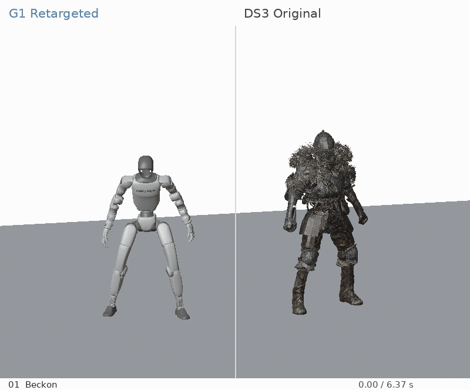
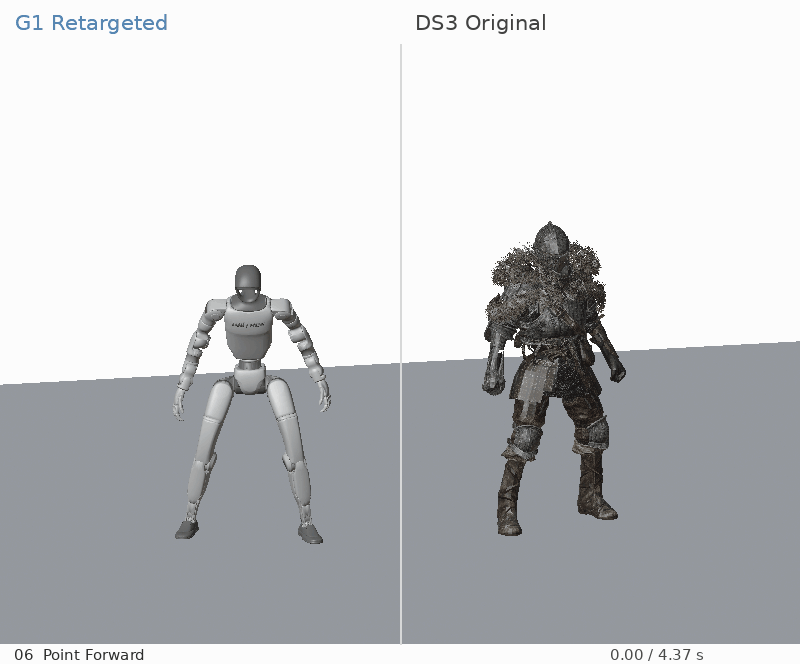
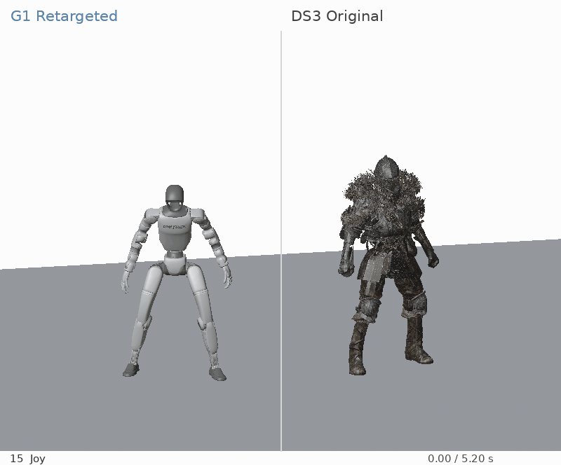
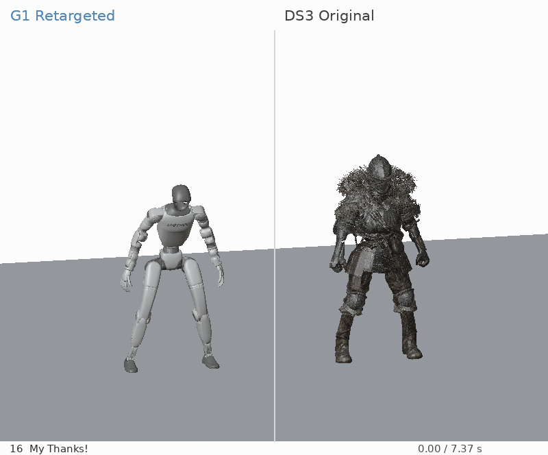
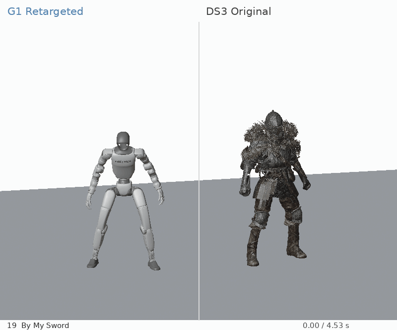
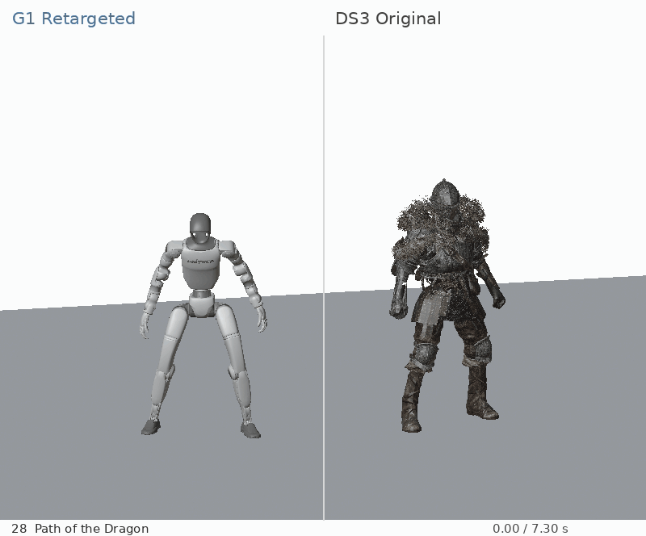
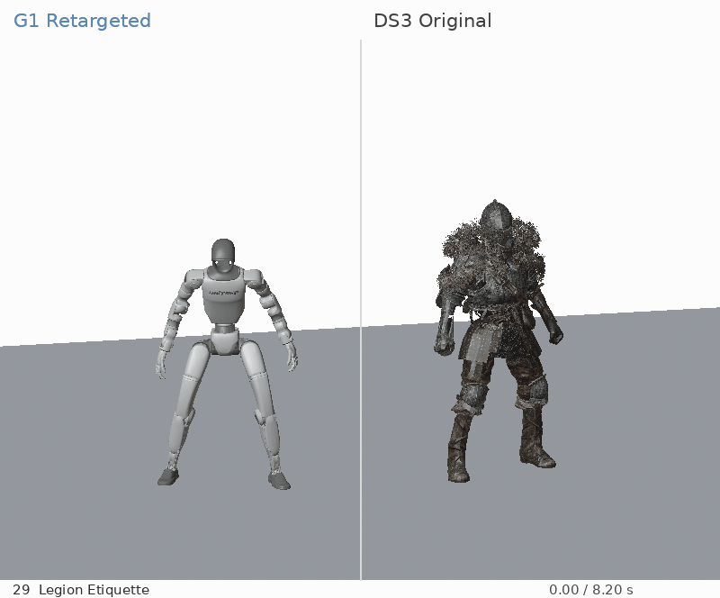
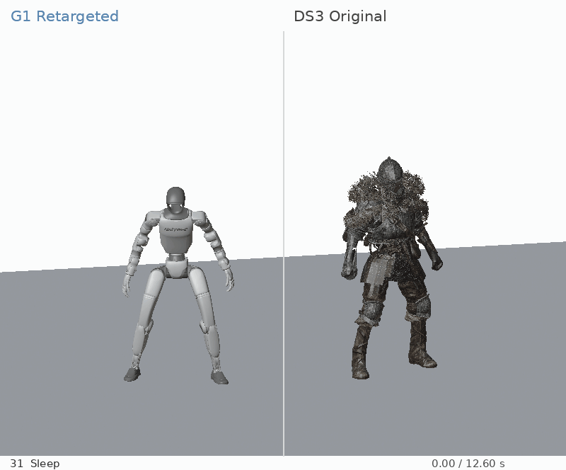

# 黑暗之魂 III 动作集：Unitree G1

[English](README.md) | **简体中文**

将《黑暗之魂 III》的 33 个主角收集类姿态重定向到 Unitree G1（29 关节）。数据包含手臂对齐、收尾姿态、地面高度修正，以及 13 个下蹲、坐下、跪地和躺卧动作的贴地支撑优化。


## 动作对比

**左侧：G1 机器人；右侧：原游戏角色。** 动图自动循环，按原速同步播放（源数据 30 FPS，动图 15 FPS）。机器人显示大小做了适配。画面为动画渲染，不是实机录像；不包含武器、杯子或布料物理。

全部 33 个动图直接嵌入下方，图片较多，可按需展开。

<details>
<summary>01 Beckon</summary>



</details>

<details>
<summary>02 Praise the Sun</summary>


</details>

<details>
<summary>03 Point Up</summary>


</details>

<details>
<summary>04 Point Down</summary>


</details>

<details>
<summary>05 Duel Bow</summary>


</details>

<details>
<summary>06 Point Forward</summary>



</details>

<details>
<summary>07 Welcome</summary>


</details>

<details>
<summary>08 Prostration</summary>


</details>

<details>
<summary>09 Proper Bow</summary>


</details>

<details>
<summary>10 Prayer</summary>


</details>

<details>
<summary>11 Bow</summary>


</details>

<details>
<summary>12 Wave</summary>


</details>

<details>
<summary>13 Hurrah</summary>


</details>

<details>
<summary>14 Jump for Joy</summary>


</details>

<details>
<summary>15 Joy</summary>



</details>

<details>
<summary>16 My Thanks</summary>



</details>

<details>
<summary>17 Rejoice</summary>


</details>

<details>
<summary>18 Rest</summary>


</details>

<details>
<summary>19 By My Sword</summary>



</details>

<details>
<summary>20 Dignified Bow</summary>


</details>

<details>
<summary>21 Curl Up</summary>


</details>

<details>
<summary>22 Stretch Out</summary>


</details>

<details>
<summary>23 Call Over</summary>


</details>

<details>
<summary>24 Collapse</summary>


</details>

<details>
<summary>25 Quiet Resolve</summary>


</details>

<details>
<summary>26 Patches Squat</summary>


</details>

<details>
<summary>27 Applause</summary>


</details>

<details>
<summary>28 Path of the Dragon</summary>



</details>

<details>
<summary>29 Legion Etiquette</summary>



</details>

<details>
<summary>30 Darkmoon Loyalty</summary>


</details>

<details>
<summary>31 Sleep</summary>



</details>

<details>
<summary>32 Toast</summary>


</details>

<details>
<summary>33 Silent Ally</summary>


</details>

## 数据与使用

- `data/g1/`：33 个无表头 CSV，每行 36 列，30 FPS。
- `manifest.json`：列顺序、帧数、时长与 SHA-256 校验值。
- [格式说明](docs/FORMAT.md) · [动作清单](docs/MOTIONS.md) · [贴地检查报告](reports/contact_report.md)。
- `media/comparisons/`：全部 33 个原游戏角色与 G1 的对比动图。
- `media/`：另外三个仅含机器人的贴地优化前后对比动图。
- `tools/validate_dataset.py`：只使用 Python 标准库的完整性与基础数值检查工具。

```sh
python3 tools/validate_dataset.py
```

每行依次为根位置 XYZ（米）、根四元数 XYZW、29 个关节角（弧度），世界坐标 Z 轴向上。请先阅读 [FORMAT](docs/FORMAT.md) 中的准确关节顺序，再用兼容的 G1 查看器播放。包内不含播放器和机器人模型；其他机器人需要重新重定向。数据不是 BVH/LAFAN1 骨架格式，不能直接发送到实机。

## 验证与已知限制

已有记录覆盖全部 33 个文件的 float32 地面及帧间/首尾接缝检查；13 个贴地优化动作额外进行了连续自碰撞与关节限位检查。检查针对当时模型，不能保证任意模型或实机安全。附带的检查工具仅验证完整性和基础数值，不重新执行几何认证。

贴地优化联合调整根高度、腿部及必要的手臂关节，相对前一处理阶段保留根水平位置、根朝向与腰部关节。部分过渡帧仍有支撑间隙：Rest 的间隙中位数由 59.6 mm 降至 6.5 mm，报告保留了 95% 分位数和最大值。

未进行动态平衡、接触力、无滑移和实机安全认证。此包是处理后数据快照，不包含可独立重现的完整提取/重定向流水线。部分姿态可能超出真实机器人的能力。


